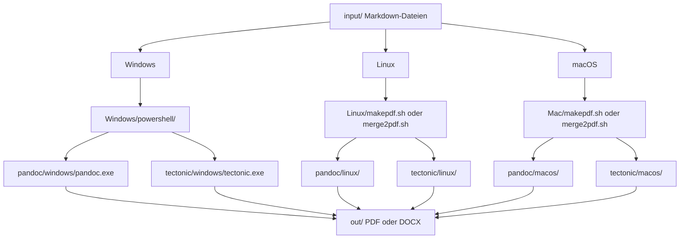

# Pandoc PDF Toolkit

Plattformübergreifendes Paket zum Konvertieren einzelner Markdown-Dateien und
zum Zusammenführen mehrerer Markdown-Dateien zu PDF oder DOCX.

## Warum dieses Projekt entstanden ist

Ich arbeite schon lange mit Pandoc. Bisher bestand mein persönlicher Workflow
vor allem aus einer BAT- beziehungsweise PowerShell-Datei, in der ich die zu
verarbeitenden Dateien jedes Mal einzeln aufgelistet habe. Das war für den
eigenen Gebrauch praktisch, aber nicht besonders bequem weiterzugeben.

Dieses Repository macht den Ablauf für andere verfügbar: Es bündelt die
benötigten Werkzeuge, bietet getrennte Startskripte für das Erstellen und
Zusammenführen von Dokumenten und ergänzt den Workflow um Einträge im
Kontextmenü. Damit lassen sich Markdown-Dateien direkt per Rechtsklick nach
PDF oder Word konvertieren, ohne vorhandene Dateien zu überschreiben.

Copyright (c) 2026 Andreas Rottmann



## Verwendung

### Windows

- Einzelne Dateien: `Windows\makepdf.bat`
- Markdown-Dateien zusammenführen: `Windows\merge2pdf.bat`

#### Kontextmenü für einzelne Markdown-Dateien

Mit `Windows\install_context_menu.ps1` kann für `.md`-Dateien das Kontextmenü
`Convert with Pandoc` installiert werden. Es enthält `Convert to PDF
(Standardformatierung)`, `Convert to PDF (ohne Standardformatierung)` und
`Convert to Word (.docx)`. Die Ausgabe wird neben der Originaldatei mit einem
Zeitstempel erzeugt, zum Beispiel `dokument_20261115-142530.pdf`.

```powershell
powershell.exe -NoProfile -ExecutionPolicy Bypass -File ".\Windows\install_context_menu.ps1"
```

Entfernen mit:

```powershell
powershell.exe -NoProfile -ExecutionPolicy Bypass -File ".\Windows\uninstall_context_menu.ps1"
```

### Linux

Zuerst die enthaltenen Programme ohne Administratorrechte installieren:

```bash
bash Linux/install.sh
```

Danach starten:

```bash
bash Linux/makepdf.sh
bash Linux/merge2pdf.sh
```

Der Installer erkennt die Linux-Distribution und die Prozessorarchitektur. Er
unterstützt x86_64 sowie ARM64, zum Beispiel Raspberry Pi OS 64-Bit.

### macOS

```bash
bash Mac/makepdf.sh
bash Mac/merge2pdf.sh
```

#### Finder-Kontextmenü

Mit `bash Mac/install_context_menu.sh` werden drei Finder-Schnellaktionen
installiert: `Convert with Pandoc - PDF (Standardformatierung)`, `Convert with
Pandoc - PDF (ohne Standardformatierung)` und `Convert with Pandoc - Word`.
Die Ausgabe wird neben der Originaldatei mit Zeitstempel erstellt. Entfernen
mit `bash Mac/uninstall_context_menu.sh`.

Für Intel-Macs sind Pandoc und Tectonic enthalten. Für Apple Silicon muss noch
die Pandoc-ARM64-Datei unter `pandoc/macos/arm64/bin/pandoc` abgelegt werden.

## Dokumentformatierung

Die PDF-Standardformatierung liegt in
[`Formatierung/header.tex`](Formatierung/header.tex) und wird von den
Konvertierungsskripten auf Wunsch eingebunden. Beim Start einer normalen
Konvertierung oder eines Zusammenführens fragt das Skript danach; die Vorgabe
`J` verwendet sie. Sie legt derzeit fest:

- A4-Seiten mit jeweils 2 cm Rand;
- blaue, türkisfarbene und dunkelgraue Überschriften je nach Ebene;
- blaue, unterstrichene Links;
- kleine, automatisch umbrochene Code-Blöcke;
- farbige Boxen für Info, Hinweis, Wichtig, Achtung, Tipp, Beispiel, Vorgehen,
  Definition, Zusammenfassung, Checkliste, Verweis und Unterrichtsmitschrift;
- Bilder an der Stelle ihres Auftretens statt als frei schwebende Elemente.

### Boxen in Markdown verwenden

Die Boxen aus `Formatierung/header.tex` stehen nur bei einer PDF-Erzeugung
**mit** Standardformatierung zur Verfügung. Sie werden in einer Markdown-Datei
als roher LaTeX-Block geschrieben. Der nachfolgende Inhalt kann direkt in eine
`.md`-Datei kopiert werden:

````markdown
```{=latex}
\begin{infobox}
Allgemeine Information.
\end{infobox}

\begin{notebox}
Ergänzender Hinweis.
\end{notebox}

\begin{importantbox}
Besonders wichtiger Inhalt.
\end{importantbox}

\begin{warningbox}
Achtung: Dieser Schritt kann Auswirkungen haben.
\end{warningbox}

\begin{tipbox}
Tipp für die praktische Arbeit.
\end{tipbox}

\begin{examplebox}
Ein konkretes Beispiel.
\end{examplebox}

\begin{stepbox}
Schritt-für-Schritt-Anleitung.
\end{stepbox}

\begin{definitionbox}
Begriffserklärung oder Definition.
\end{definitionbox}

\begin{summarybox}
Kurze Zusammenfassung.
\end{summarybox}

\begin{checklistbox}
\begin{itemize}
  \item Erster Prüfschritt
  \item Zweiter Prüfschritt
\end{itemize}
\end{checklistbox}

\begin{referencebox}
Weiterführende Quelle oder Verweis.
\end{referencebox}

\begin{unterrichtbox}
Notizen aus dem Unterricht.
\end{unterrichtbox}
```
````

Für Word-Ausgaben und PDFs ohne Standardformatierung sind diese LaTeX-Boxen
nicht geeignet. Der übrige Markdown-Inhalt wird dennoch normal konvertiert.

### Formatierung direkt in einer Markdown-Datei

Zusätzlich kann jede Markdown-Datei am Anfang eigene Metadaten enthalten. Der
Block beginnt und endet mit `---` und muss vor dem ersten Inhalt stehen:

```markdown
---
title: "Entscheidungsbaum"
author: "Andreas Rottmann"
date: 2026-11-15
lang: de-AT
toc: true
toc-depth: 3
numbersections: true
fontsize: 11pt
---

# Einleitung

Hier beginnt der Dokumentinhalt.
```

Dieser YAML-Block und die Standarddatei `Formatierung/header.tex` werden
gemeinsam eingelesen. Angaben wie Titel, Autor, Datum, Sprache,
Inhaltsverzeichnis, Abschnittsnummerierung und Schriftgröße sind daher
unproblematisch und gelten nur für diese Datei.

Nicht doppelt festlegen solltest du hingegen LaTeX-Pakete oder deren Optionen,
die bereits im Header stehen. Insbesondere darf in der Markdown-Datei nicht
noch einmal `geometry` mit eigenen Rändern geladen werden, da LaTeX dann einen
Paketkonflikt melden kann. Für eine projektweit einheitliche Gestaltung bleibt
`Formatierung/header.tex` deshalb der richtige Ort; das YAML im Markdown ist
für dokumentbezogene Angaben gedacht.

## Ordner

- `input/`: einzelne Markdown-Eingabedateien
- `merge/`: Ordner mit Markdown-Dateien zum Zusammenführen
- `out/`: erzeugte PDF- und DOCX-Dateien
- `Formatierung/header.tex`: optionale PDF-Formatierung
- `pandoc/` und `tectonic/`: Programme, getrennt nach Betriebssystem

## Lizenz

Dieses Projekt ist unter der **GNU General Public License v3.0** lizenziert.
Der vollständige Text steht in [LICENSE](LICENSE).

Die enthaltenen Drittprogramme bleiben unter ihren jeweiligen Lizenzen:
Pandoc unter GPL-2.0-or-later und Tectonic unter der MIT-Lizenz. Die zugehörigen
Lizenzhinweise in den jeweiligen Programmordnern müssen bei Weitergabe erhalten
bleiben.
