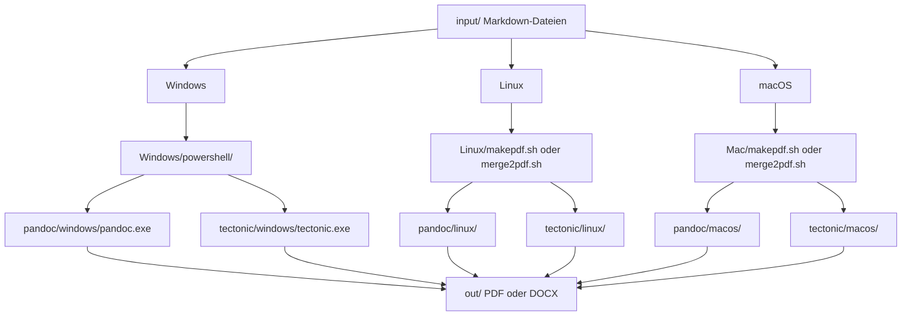

# Pandoc PDF Toolkit

Plattformübergreifendes Paket zum Konvertieren einzelner Markdown-Dateien und
zum Zusammenführen mehrerer Markdown-Dateien zu PDF oder DOCX.

Copyright (c) 2026 Andreas Rottmann



## Verwendung

### Windows

- Einzelne Dateien: `Windows\makepdf.bat`
- Markdown-Dateien zusammenführen: `Windows\merge2pdf.bat`

### Linux

Zuerst die enthaltenen Programme ohne Administratorrechte installieren:

```bash
bash Linux/install.sh
```

Danach starten:

```bash
bash Linux/makepdf.sh
bash Linux/merge2pdf.sh
```

Der Installer erkennt die Linux-Distribution und die Prozessorarchitektur. Er
unterstützt x86_64 sowie ARM64, zum Beispiel Raspberry Pi OS 64-Bit.

### macOS

```bash
bash Mac/makepdf.sh
bash Mac/merge2pdf.sh
```

Für Intel-Macs sind Pandoc und Tectonic enthalten. Für Apple Silicon muss noch
die Pandoc-ARM64-Datei unter `pandoc/macos/arm64/bin/pandoc` abgelegt werden.

## Ordner

- `input/`: einzelne Markdown-Eingabedateien
- `merge/`: Ordner mit Markdown-Dateien zum Zusammenführen
- `out/`: erzeugte PDF- und DOCX-Dateien
- `Formatierung/header.tex`: optionale PDF-Formatierung
- `pandoc/` und `tectonic/`: Programme, getrennt nach Betriebssystem

## Lizenz

Dieses Projekt ist unter der **GNU General Public License v3.0** lizenziert.
Der vollständige Text steht in [LICENSE](LICENSE).

Die enthaltenen Drittprogramme bleiben unter ihren jeweiligen Lizenzen:
Pandoc unter GPL-2.0-or-later und Tectonic unter der MIT-Lizenz. Die zugehörigen
Lizenzhinweise in den jeweiligen Programmordnern müssen bei Weitergabe erhalten
bleiben.
